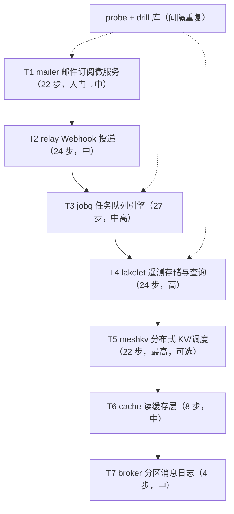

# 课程体系与能力模型

> 配套：[规划与工程决策](plan.md)、[编写规范](authoring.md)。
> 本文件是课程内容的唯一导航：能力台账、track 依赖关系、每条 track 的步骤清单、跨 track 去重的实例对照。

## 1. 设计目标

用户要求：「项目可以多准备几个，从简单到复杂，同时保证复杂项目中不用再重复完成简单项目中的相似内容」。

这句话拆成三个必须同时满足的约束：

1. **多项目、难度递增**：不同项目对应不同的工程规模与失败模式，只在真实项目里才会全部出现。
2. **不重复教学**：同一能力不在不同项目里从零讲一遍。
3. **仍要长本事**：不能因为「学过」就跳过实现——在陌生项目里把已学能力用出来，是独立的一项能力（迁移）。

满足方式：**能力（capability）+ 深度（level）** 是课程的货币，每个步骤声明它教什么、到哪个深度；
跨 track 的重复由 `kiln lint-caps` 机械拦住（§2.3），迁移步骤用专门的正文模板（§2.4）。

## 2. 能力模型

### 2.1 深度

| level | 含义 | 证据形式 |
| --- | --- | --- |
| `aware` | 能读懂、能改；知道它为什么存在 | 讲解 + 一个能失败的测试 |
| `apply` | 能在没有引导的情况下从零实现 | 规格测试 + 闸门 |
| `design` | 能讲清取舍、做出选型、写出 ADR | 设计文档闸门 + 能证明取舍的测试 |
| `operate` | 能在生产里排障、调优、演练 | 故障演练 / soak / 模拟测试 + runbook |

深度只能沿路径升级：`aware → apply → design → operate`。降级重讲必须显式标 `reteach = "理由"`。

### 2.2 声明方式

```toml
[[step]]
id = "2.15-shutdown-leases"
origin = "deepen"                     # teach | deepen | transfer
teaches = ["async/graceful-shutdown@operate"]
requires = ["async/graceful-shutdown@apply", "db/atomic-claim@apply"]
```

- `teaches` 的每个条目必须绑到本步至少一个闸门或规格测试——**只讲不考不允许**。
- `requires` 必须在该步之前已被 teach/deepen 覆盖，否则 `lint-caps` 报不可达。

### 2.3 `kiln lint-caps` 的六条规则

| # | 规则 | 拦住的坏味道 |
| --- | --- | --- |
| R1 | 同一 track 内同一能力不得在同深度重教 | 换个说法重讲一遍 |
| R2 | 全路径上同一能力的深度严格递增（除非 `reteach`） | 复杂项目里把基础重新讲一遍 |
| R3 | 每个 `requires` 在该步之前已覆盖 | 跳步导致的知识断层 |
| R4 | 每个 `teaches` 至少绑一个闸门/规格 | 「讲了等于学会了」 |
| R5 | `origin = deepen/transfer` 的正文不得有 WHY 段；`teach` 必须有 WHY 段 | 迁移步里塞回入门讲解 |
| R6 | 每条 track 声明的 `exit` 能力必须被本 track 覆盖 | 出口能力名不副实 |

规则 R1/R2/R3/R6 是纯元数据检查（快）；R5 检查正文结构。全部在 CI 与 `kiln selftest` 里跑。

### 2.4 三种正文模板

| origin | 何时用 | 模板 |
| --- | --- | --- |
| `teach` | 该能力该深度第一次出现 | WHY / TASK / DONE WHEN / TRAP / FURTHER |
| `deepen` | 同能力升到更深深度 | RECALL（上次在哪学的）/ DELTA（这次多出什么）/ TASK / DONE WHEN / TRAP |
| `transfer` | 同能力同深度，换项目再做一遍 | RECALL / DELTA（新项目里的坑）/ TASK / DONE WHEN / TRAP，且**闸门更严、提示更少** |

学员走到 `deepen`/`transfer` 步时，`kiln` 打印 RECALL 卡片：
> `async/graceful-shutdown@apply` 你在 `mailer/1.14` 学过（约 62 天前）。本次 DELTA：在途任务持有数据库租约，drop 的代价从「丢一次投递」变成「30 秒内不可见」。

## 3. 能力台账

`course/capabilities.toml` 的注册表。每个能力一行，标注四个深度各自在哪一步被建立；空白=不教（保持空白是诚实的，不假装覆盖）。

### 3.1 工程基础

| 能力 | aware | apply | design | operate |
| --- | --- | --- | --- | --- |
| `repo/workspace-layout` | — | T1·1.1 | — | — |
| `repo/toolchain-pinning` | — | T1·1.2 | T4·4.22 | — |
| `ci/pipeline` | — | T1·1.3 | T4·4.22 | — |
| `cfg/layered-config` | — | T1·1.4 | T3·3.4 | — |
| `sec/secrets-management` | — | T1·1.4 | T4·4.23 | — |
| `err/typed-errors` | — | T1·1.5 | T3·3.3 | — |
| `obs/structured-logs` | — | T1·1.6 | T3·3.17 | — |
| `obs/tracing-propagation` | T1·1.6 | T2·2.19 | — | T3·3.18 |
| `obs/metrics-slo` | T1·1.20 | T2·2.18 | T3·3.17 | T5·5.18 |
| `obs/cardinality-cost` | — | T4·4.18 | — | — |
| `supply/deny-policy` | — | T2·2.21 | T4·4.22 | — |
| `unsafe/budget` | T2·2.21 | T3·3.24 | — | — |

### 3.2 HTTP 与接口

| 能力 | aware | apply | design | operate |
| --- | --- | --- | --- | --- |
| `http/service-skeleton` | — | T1·1.7 | — | — |
| `http/middleware-layering` | — | T2·2.1 | — | — |
| `http/rate-limit` | — | T2·2.13 | T3·3.9 | — |
| `api/contract-testing` | — | T2·2.3 | — | — |
| `api/pagination` | — | T2·2.4 | — | — |
| `api/idempotency-key` | — | T2·2.2 | T5·5.8 | — |
| `api/library-design` | T3·3.1 | T3·3.2 | — | — |
| `api/client-sdk` | — | T5·5.11 | — | — |
| `cli/contract` | — | T3·3.15 | T3·3.26 | — |
| `query/consistency-levels` | — | T5·5.12 | — | — |

### 3.3 领域与安全

| 能力 | aware | apply | design | operate |
| --- | --- | --- | --- | --- |
| `domain/parse-dont-validate` | — | T1·1.10 | — | — |
| `domain/state-machine` | — | T3·3.14 | — | — |
| `sec/password-hash` | — | T1·1.11 | — | — |
| `sec/token-lifetime` | — | T1·1.12 | — | — |
| `sec/authn-session` | — | T1·1.16 | — | — |
| `sec/authz-tenant-isolation` | — | T1·1.18 | T2·2.16 | T3·3.13 |
| `sec/hmac-signing` | — | T2·2.11 | — | — |
| `sec/ssrf-defense` | — | T2·2.12 | — | — |
| `sec/mtls` | — | T5·5.9 | — | — |

### 3.4 异步运行时

| 能力 | aware | apply | design | operate |
| --- | --- | --- | --- | --- |
| `async/backpressure` | T1·1.14 | T2·2.14 | T4·4.6 | — |
| `async/graceful-shutdown` | — | T1·1.14 | T2·2.15 | T3·3.7 |
| `time/clock-injection` | — | T3·3.8 | — | — |
| `io/batching` | — | — | T4·4.5 | — |

### 3.5 数据与投递

| 能力 | aware | apply | design | operate |
| --- | --- | --- | --- | --- |
| `db/migrations` | — | T1·1.9 | — | — |
| `db/unique-as-concurrency` | — | T1·1.11 | T3·3.6 | — |
| `db/transactions` | — | T1·1.17 | T3·3.6 | — |
| `db/atomic-claim` | — | T2·2.5 | T3·3.7 | — |
| `db/port-conformance` | — | T3·3.5 | — | — |
| `db/schema-online-evolution` | T2·2.23 | T3·3.23 | — | — |
| `delivery/idempotency` | — | T1·1.15 | T3·3.12 | — |
| `delivery/at-least-once` | — | — | T2·2.6 | — |
| `delivery/ordering` | — | T2·2.9 | — | — |
| `delivery/retry-budget` | — | — | T2·2.8 | — |
| `delivery/dlq` | — | T2·2.10 | — | T3·3.16 |
| `ops/dlq-tooling` | — | T3·3.16 | — | T3·3.26 |
| `outbound/http-client` | — | T2·2.7 | T4·4.21 | — |

### 3.6 调度、存储、查询

| 能力 | aware | apply | design | operate |
| --- | --- | --- | --- | --- |
| `sched/cron` | — | T3·3.10 | — | — |
| `sched/delayed-timers` | — | T3·3.11 | — | — |
| `sched/fairness` | — | — | T3·3.9 | — |
| `ingest/protocol` | — | T4·4.1 | — | — |
| `store/wal-recovery` | T4·4.3 | T4·4.4 | — | — |
| `store/columnar` | — | T4·4.7 | — | — |
| `store/compaction` | — | — | T4·4.8 | — |
| `store/retention` | — | T4·4.9 | — | — |
| `store/tiering` | — | T4·4.21 | — | — |
| `query/downsampling` | — | T4·4.10 | — | — |
| `query/index-pruning` | — | T4·4.14 | — | — |
| `query/engine` | — | — | T4·4.11 | — |
| `num/aggregation-correctness` | — | T4·4.12 | — | — |

### 3.7 质量、性能、交付

| 能力 | aware | apply | design | operate |
| --- | --- | --- | --- | --- |
| `test/app-factory` | — | T1·1.8 | — | — |
| `test/fake-external` | — | T1·1.13 | — | — |
| `test/integration-layering` | — | T1·1.19 | — | — |
| `test/chaos-injection` | — | T2·2.17 | T5·5.16 | — |
| `test/property-based` | — | T3·3.19 | — | — |
| `test/mutation` | — | T3·3.20 | — | — |
| `test/coverage-policy` | — | T3·3.21 | — | — |
| `test/fuzzing` | — | T4·4.2 | — | — |
| `test/model-based` | — | T4·4.13 | — | — |
| `test/deterministic-simulation` | — | — | T5·5.13 | — |
| `perf/bench-budget` | — | T3·3.22 | — | T4·4.15 |
| `perf/load-testing` | — | T2·2.20 | — | — |
| `perf/profiling` | — | — | — | T4·4.16 |
| `perf/soak` | — | T4·4.17 | — | — |
| `perf/distributed-budget` | — | — | T5·5.17 | — |
| `release/container-image` | — | T1·1.21 | T4·4.22 | — |
| `release/artifacts` | — | T3·3.25 | — | — |
| `ops/runbook-drill` | — | T1·1.22 | T3·3.27 | T4·4.24 |
| `ops/degradation-modes` | — | T2·2.24 | — | — |
| `ops/rolling-upgrade` | — | T2·2.22 | T5·5.21 | — |
| `ops/backup-restore` | — | T4·4.19 | — | — |
| `ops/capacity-cost` | — | — | T4·4.20 | — |
| `build/reproducibility` | — | T4·4.22 | — | — |
| `unsafe/hand-rolled` | — | — | — | T5·5.19 |
| `api/library-reuse` | — | — | T5·5.20 | — |
| `dist/protocol-evolution` | — | — | T5·5.21 | — |
| `ops/cluster-drill` | — | — | — | T5·5.15 |
| `dist/topology` | — | T5·5.1 | — | — |
| `dist/consensus` | T5·5.2 | T5·5.3 | — | — |
| `dist/snapshot` | — | — | T5·5.4 | — |
| `dist/membership` | — | T5·5.5 | — | — |
| `dist/linearizable-read` | — | — | T5·5.6 | — |
| `dist/client-routing` | — | T5·5.7 | — | — |
| `dist/deterministic-state-machine` | — | T5·5.10 | — | — |
| `dist/partition-drill` | — | — | — | T5·5.14 |
| `dist/consistency-audit` | — | — | — | T5·5.22 |

### 3.8 缓存

| 能力 | aware | apply | design | operate |
| --- | --- | --- | --- | --- |
| `cache/read-through` | — | T6·6.1 | — | — |
| `cache/invalidation` | — | T6·6.2 | — | — |
| `cache/single-flight` | — | T6·6.3 | — | — |
| `cache/expiry-jitter` | — | T6·6.4 | — | — |
| `cache/versioned-keys` | — | T6·6.5 | — | — |
| `cache/two-level` | — | T6·6.6 | — | — |
| `obs/cache-effectiveness` | — | — | — | T6·6.7 |
| `ops/cache-failure` | — | — | — | T6·6.8 |

### 3.9 消息中间件

| 能力 | aware | apply | design | operate |
| --- | --- | --- | --- | --- |
| `broker/partitioning` | — | T7·7.1 | — | — |
| `broker/consumer-offset` | — | T7·7.2 | — | — |
| `broker/rebalance` | — | T7·7.3 | — | — |
| `broker/lag` | — | T7·7.4 | — | — |

**这张表就是「不重复」的证明**：一个能力在四个深度上各只出现一次，跨 track 只是换项目、换难度、换失败模式。

## 4. 去重实例：同一能力的四次出现

### 4.1 `async/graceful-shutdown`

| 深度 | 位置 | 这次真正新增的内容 | **不再重复的内容** |
| --- | --- | --- | --- |
| `apply` | T1·1.14 | SIGTERM 语义、CancellationToken、停止接收→排空→超时强退、子进程集成测试 | —（首次） |
| `design` | T2·2.15 | 在途任务持有数据库租约：drop 的代价是「30 秒不可见」；租约时长与恢复延迟的取舍 | 信号处理、drain 流程、测试写法 |
| `operate` | T3·3.7 | 崩溃回收、续约失败、时钟偏移下的可观测与调优；滚动升级时的双领窗口 | drain 流程、信号、测试写法 |
| 更远 | （预留） | 集群优雅下线与成员变更 | 同上 |

### 4.2 迁移相关：`db/migrations` 与它派生出的新能力

模型的关键区分：**「会用迁移工具」与「能在不停机的前提下改 schema」是两种能力**，后者是新能力，不算重复。

| 能力 | 深度 | 位置 | 新增 | 不再重复 |
| --- | --- | --- | --- | --- |
| `db/migrations` | `apply` | T1·1.9 | 前向迁移（版本在文件名、`_sqlx_migrations` 记录已应用的版本）、迁移内嵌进二进制（`sqlx::migrate!`）、启动顺序（连库 → 迁移 → 再 listen）、就绪与存活之分 | —（首次） |
| `db/schema-online-evolution` | `aware` | T2·2.23 | 老代码与新 schema 必须共存多久、发布窗口 | 迁移工具用法（已在 T1） |
| `db/schema-online-evolution` | `apply` | T3·3.23 | expand → backfill → contract 全流程、回填的批处理与限速 | 迁移工具用法、offline 数据 |
| `build/reproducibility` | `apply` | T4·4.22 | 迁移与可复现构建、破坏性变更的发布窗口 | 迁移本身 |

> 落地结果（1.9 / 1.11，2026-10）：1.9 的第一条查询用运行时的 `sqlx::query(…)`（同时保证「无数据库也能
> 编译」），编译期校验的 `query_scalar!` 与 `.sqlx/` 离线元数据跟着 1.11 的第一条真实查询一起上，
> 由 scaffold 发布，所以没有数据库的机器照样编译。一处与规划不同：**语句写在正文里，而不是 scaffold 的
> `pub const`**——`sqlx` 0.9 的宏按 `LitStr` 解析 `source`。过程见
> [handoff-m0-log.md](handoff-m0-log.md) 第六段。

### 4.3 `sec/authz-tenant-isolation`

| 深度 | 位置 | 新增 | 不再重复 |
| --- | --- | --- | --- |
| `apply` | T1·1.18 | 资源级归属检查、越权返回 404 而非 403 | —（首次） |
| `design` | T2·2.16 | 授权矩阵、审计日志、调试后门的最小化 | 基本归属检查 |
| `operate` | T3·3.13 | 队列级配额、跨租户噪声邻居、用量归因 | 归属检查、矩阵设计 |

### 4.4 `obs/metrics-slo`

| 深度 | 位置 | 新增 | 不再重复 |
| --- | --- | --- | --- |
| `aware` | T1·1.20 | 黄金指标、`/metrics`、指标命名约定 | —（首次） |
| `apply` | T2·2.18 | 投递延迟分位、积压深度、按租户分解 | 指标命名与导出 |
| `design` | T3·3.17 | 错误预算、告警阈值与降噪、无指标时的降级判断 | 导出方式 |
| `operate` | T5·5.18 | 集群态指标、分片不均、脑裂期的观测 | 同上 |

## 5. Track 总览



依赖方向只有一条链（每条 track 的入口能力由前一条的出口覆盖），但**代码不共享**（plan.md §3 D6）。
probe/drill 与 track 解耦：任何深度都可以被抽查。

| track | 入口能力（节选） | 出口能力（节选） | origin 分布 |
| --- | --- | --- | --- |
| T1 `mailer` | rustlings 水平 | 服务骨架、类型化错误、迁移、后台 worker、可观测基线、容器发布 | 22 teach |
| T2 `relay` | T1 全部 apply 级 | 至少一次投递、顺序与幂等、DLQ、签名、SSRF、限流、多租户 | 18 teach + 1 transfer + 5 deepen |
| T3 `jobq` | T2 出口 + 库设计入门 | 库设计、事务深化、租约、cron、变异/覆盖率/基准、在线演进 | 11 teach + 1 transfer + 14 deepen（在建） |
| T4 `lakelet` | T3 出口 + 性能入门 | WAL 恢复、列式与压缩、查询引擎、批处理、剖析与 soak | 编写时由 `lint-caps` 统计 |
| T5 `meshkv` | T4 出口 | 共识、成员变更、确定性模拟、线性一致读、mTLS、集群演练 | 编写时由 `lint-caps` 统计 |
| T6 `cache` | T1 的读写习惯 | 读穿、失效、单飞、过期抖动、版本化键、两层、SLO、熔断 | 8 teach |
| T7 `broker` | T1 的读写习惯 | 分区路由、提交偏移、再平衡、lag | 4 teach（进行中，后续五步见 [m6-plan.md](m6-plan.md)） |

## 6. T1 `mailer`：邮件订阅微服务（22 步，**已交付**）

题材与推进顺序参考《Zero To Production in Rust》(Luca Palmieri)：订阅、确认、发布 newsletter。
我们在此之上补上原书场景之外的生产砝码：带真实队列的后台投递与幂等、SLO、负载测试、变异测试、runbook 演练。

**状态：22/22 已交付**（正文、规格、scaffold、参考解、闸门接线全部就位，验收冻结在 `c08f33a`）。
逐步的交付物、门阶梯、项目最后的形状、可照抄到 T2–T5 的模式与实测数字见
**[t1-mailer.md](t1-mailer.md)**；正文在 `course/docs/steps/en/mailer/`，元数据在
`course/tracks/mailer/track.toml`。下面的表是**规划口径**，留作能力分布与检索用——每步的过关条件
不再在这里重复，那是正文与规格的事。

### 阶段 A：骨架与工具链（1.1–1.6）

| # | 步骤 | teaches |
| --- | --- | --- |
| 1.1 | workspace 与 lib/bin 拆分（`main.rs` 只剩一层壳） | `repo/workspace-layout@apply` |
| 1.2 | 工具链与风格锁定：`rust-toolchain.toml`、`rustfmt.toml`、`[workspace.lints]`、MSRV 政策 | `repo/toolchain-pinning@apply` |
| 1.3 | 一条命令跑通全部检查（`cargo xtask ci`）+ CI 落地 | `ci/pipeline@apply` |
| 1.4 | 类型化配置与启动：file/env/flag 覆盖顺序、`--check-config`、密钥不入库 | `cfg/layered-config@apply`、`sec/secrets-management@apply` |
| 1.5 | 错误处理即 API：`thiserror` 领域错误、`anyhow` 仅在边界、`source` 链、退出码映射（同一套失败分类在 1.7 起映射到 HTTP 状态码） | `err/typed-errors@apply` |
| 1.6 | 结构化日志与关联 id：JSON/pretty 双模式、`#[instrument]`、span 传播（此时的工作单位是「一次运行」，1.7 起用同一个机制包住每个 HTTP 请求） | `obs/structured-logs@apply`、`obs/tracing-propagation@aware` |

### 阶段 B：服务与数据（1.7–1.13）

| # | 步骤 | teaches |
| --- | --- | --- |
| 1.7 | HTTP 骨架：axum 路由、extractor、`/healthz`、优雅的 404/405 | `http/service-skeleton@apply` |
| 1.8 | 端到端测试基建：app 工厂、随机端口、每测试独立 schema | `test/app-factory@apply` |
| 1.9 | Postgres 与迁移：连接池、`sqlx::migrate!`（迁移内嵌进二进制）、启动顺序、`/readyz` 与 `/healthz` 之分 | `db/migrations@apply` |
| 1.10 | 领域类型：`Email`/`SubscriberName`/`Password`，解析即校验 | `domain/parse-dont-validate@apply` |
| 1.11 | 注册流程：`argon2` 哈希、唯一约束当并发原语 | `sec/password-hash@apply`、`db/unique-as-concurrency@apply` |
| 1.12 | 确认令牌：签发/校验/过期/一次性使用 | `sec/token-lifetime@apply` |
| 1.13 | 邮件发送端口 + 假实现（依赖注入，不用 mock 框架） | `test/fake-external@apply` |

### 阶段 C：后台与边界（1.14–1.18）

| # | 步骤 | teaches |
| --- | --- | --- |
| 1.14 | 后台投递 worker：有界队列、重试与抖动、停机时排空 | `async/graceful-shutdown@apply`、`async/backpressure@aware` |
| 1.15 | 幂等投递：同一封确认信不重复发（去重键 + 状态机） | `delivery/idempotency@apply` |
| 1.16 | 会话与鉴权：cookie session vs API key 的取舍 | `sec/authn-session@apply` |
| 1.17 | 发布 newsletter：事务内批量写入 + 后台扇出 | `db/transactions@apply` |
| 1.18 | 权限边界：订阅者只能读自己的数据（越权给 404） | `sec/authz-tenant-isolation@apply` |

### 阶段 D：质量与交付（1.19–1.22）

| # | 步骤 | teaches |
| --- | --- | --- |
| 1.19 | 测试分层与真实外部依赖：mailpit 容器、故障注入的假实现 | `test/integration-layering@apply` |
| 1.20 | 指标与 SLO 基线：`/metrics`、黄金指标、告警草案 | `obs/metrics-slo@aware` |
| 1.21 | 容器化与部署：多阶段镜像、探针、迁移与启动的顺序 | `release/container-image@apply` |
| 1.22 | runbook + 首次故障演练：DB 断连、邮件服务 500、迁移失败 | `ops/runbook-drill@apply` |

### 配套 drill（可选插入）

| drill | 放在哪一步前 | 练什么 |
| --- | --- | --- |
| `drill/async-select-cancellation` | 1.14 | `select!` 的 drop 语义、取消安全 |
| `drill/serde-try-from` | 1.10 | `#[serde(try_from)]` 与解析即校验 |
| `drill/sqlx-transaction-basics` | 1.17 | 事务边界与 `?` 的传播 |

## 7. T2 `relay`：Webhook 投递服务（24 步）

**状态：24/24 已交付**（正文、规格、scaffold、参考解、闸门接线全部就位；`kiln verify relay` 在最终树上
`24/24 judged pass`）。交付物一览、门阶梯、项目最终形状与实测数字见 **[t2-relay.md](t2-relay.md)**；
逐步的施工过程与两次红的判读见 [handoff-m1-log.md](handoff-m1-log.md)。下面的表是**规划口径**。

题材：接收事件 → 持久化 → 按订阅者投递（HTTP POST + HMAC 签名）→ 重试/退避 → DLQ → 多租户 → 限流。
它是「至少一次投递」这一类问题的标准现场，且把 T1 的每个能力都换到更难的环境里迁移一遍。

| # | 步骤 | origin | teaches / 迁移对象 | 过关条件（要点） |
| --- | --- | --- | --- | --- |
| 2.1 | 项目骨架与多租户数据模型（以规格为准重建服务） | transfer | 迁移 T1 的 workspace/config/logging/migrations；新增 `http/middleware-layering@apply` | 规格测试 + 更严的 `clippy@2`，无提示 |
| 2.2 | 事件接收与幂等 POST（`Idempotency-Key` + 唯一约束） | teach | `api/idempotency-key@apply` | 同 key 重复提交只产生一个事件 |
| 2.3 | 契约优先：OpenAPI 由类型生成、快照、契约测试 | teach | `api/contract-testing@apply` | 契约快照 + 新旧客户端兼容测试 |
| 2.4 | 分页与过滤：游标分页、稳定排序、索引 | teach | `api/pagination@apply` | 翻页不重不漏（property 测试） |
| 2.5 | 原子领取：`SELECT … FOR UPDATE SKIP LOCKED` | teach | `db/atomic-claim@apply` | 8 连接并发零重复领取 |
| 2.6 | 至少一次投递的语义与不变量（不丢；可能重） | teach | `delivery/at-least-once@design` | ADR + 能证明不丢的测试 |
| 2.7 | 出站 HTTP 客户端：连接池、超时分层、keep-alive、重定向策略 | teach | `outbound/http-client@apply` | 慢下游/断连/重定向矩阵 |
| 2.8 | 重试预算与退避：抖动、上限、熔断 | teach | `delivery/retry-budget@design` | 假时钟驱动的确定性重试测试 |
| 2.9 | 顺序与并发：按订阅者串行化，避免惊群 | teach | `delivery/ordering@apply` | 同订阅者顺序断言 + 全局吞吐断言 |
| 2.10 | DLQ 与毒丸隔离：重试上限、隔离、可观测 | teach | `delivery/dlq@apply` | 毒丸不阻塞其他订阅者 |
| 2.11 | 签名：HMAC + 时间戳 + 常数时间比较 | teach | `sec/hmac-signing@apply` | 篡改/重放/时钟偏移测试 |
| 2.12 | SSRF 防护：目标校验、DNS 重绑定、私网段、重定向跟随 | teach | `sec/ssrf-defense@apply` | 恶意目标矩阵全部拒绝 |
| 2.13 | 限流与配额：按租户令牌桶、公平性 | teach | `http/rate-limit@apply` | 突刺下不误伤其他租户 |
| 2.14 | 背压与并发上限：信号量、公平调度、饥饿 | teach | `async/backpressure@apply` | 下游慢时内存有界且不饿死 |
| 2.15 | 停机深化：在途租约的回收与快速恢复 | deepen | `async/graceful-shutdown@design` | kill -9 后租约超时回收，无永久卡死 |
| 2.16 | 授权矩阵与审计日志 | deepen | `sec/authz-tenant-isolation@design` | 越权矩阵 + 审计可追溯 |
| 2.17 | 故障注入：toxiproxy（延迟、断连、半开） | teach | `test/chaos-injection@apply` | 注入下不丢单、能自愈 |
| 2.18 | 投递可观测：延迟分位、积压深度、按租户分解 | deepen | `obs/metrics-slo@apply` | 指标能定位是哪一类租户变慢 |
| 2.19 | 追踪跨边界传播（W3C traceparent） | deepen | `obs/tracing-propagation@apply` | 一条追踪串起接收→投递→下游 |
| 2.20 | 负载测试与容量估算（p99 目标、队列深度 vs worker 数） | teach | `perf/load-testing@apply` | 达到目标的并发与延迟曲线 |
| 2.21 | 供应链政策：`cargo-deny`、许可、默认拒绝 unsafe | teach | `supply/deny-policy@apply`、`unsafe/budget@aware` | `deny` 全绿 |
| 2.22 | 部署与滚动升级：探针语义、迁移顺序、双版本并存 | teach | `ops/rolling-upgrade@apply` | 升级期间零 5xx |
| 2.23 | 在线 schema 变更的第一次规模 | teach | `db/schema-online-evolution@aware` | 新旧代码并存读写通过 |
| 2.24 | runbook v2 + 故障演练：DB 断连、下游慢、租户风暴 | deepen | `ops/degradation-modes@apply`（新增能力），并深化 T1 的 runbook 演练 | 三类演练脚本可复跑 |

## 8. T3 `jobq`：通用任务队列引擎（27 步）

**状态：在建**（元数据、项目骨架与门阶梯已落地，逐步交付进度见
[handoff-m2.md](handoff-m2.md) §2 与 [handoff-m2-log.md](handoff-m2-log.md)）。
下面这张表是规划口径；实际交付以 `course/tracks/jobq/track.toml`（唯一真源）为准。

origin 分布：**11 teach + 1 transfer（3.1）+ 14 deepen**；`exit` 能力见 `track.toml`。
门阶梯：`clippy@2` 起，3.3 升 `@3`，3.20 升 `@4`；`semver@baseline` 从 3.2 起持久，
`slow:conformance@2` 写在「判的就是存储端口」的步骤上。

题材：把 T2 里临时实现的投递逻辑提炼成**可复用的引擎**（库 + worker 服务 + CLI）。
这条 track 的重点从「写服务」转向「设计给别人用的东西」与「用工具证明质量」。

| # | 步骤 | teaches | 过关条件（要点） |
| --- | --- | --- | --- |
| 3.1 | 引擎边界：从服务里提炼库的公开面 | `api/library-design@aware` | 依赖方向检查（引擎不依赖服务） |
| 3.2 | 公开 API 与 semver 基线：`pub(crate)`、re-export、sealed、`#[non_exhaustive]` | `api/library-design@apply` | 公开面快照 + `semver` 闸门 |
| 3.3 | 库的错误设计：公开错误类型、`#[source]` 契约、文案稳定性 | `err/typed-errors@design` | 错误快照测试 |
| 3.4 | feature flags 与编译期装配（含统一性陷阱） | `cfg/layered-config@design` | 多配置矩阵构建通过 |
| 3.5 | 存储端口与一致性套件（内存 vs PG 共用一套测试） | `db/port-conformance@apply` | `conformance` 闸门 |
| 3.6 | 事务与隔离级深化：序列化冲突重试、唯一约束 vs 应用锁 | `db/transactions@design`、`db/unique-as-concurrency@design` | 冲突注入下正确重试 |
| 3.7 | 租约、可见性超时、续约与崩溃回收 | `db/atomic-claim@design`、`async/graceful-shutdown@operate` | 多 worker 下不双跑、不卡死；崩溃后按租约回收 |
| 3.8 | 时间即依赖：`Clock` trait、单调时间、禁止业务代码取系统时间 | `time/clock-injection@apply` | `disallowed_methods` + 假时钟测试 |
| 3.9 | 优先级与公平调度（饥饿、租户配额、限流的设计面） | `sched/fairness@design`、`http/rate-limit@design` | 饥饿场景测试 |
| 3.10 | cron 表达式与错过执行（时区/DST） | `sched/cron@apply` | DST 与漏跑场景测试 |
| 3.11 | 延迟任务与定时器（时间轮 vs 堆 vs 顺序扫描） | `sched/delayed-timers@apply` | 大时间跨度下的正确性与内存 |
| 3.12 | 幂等与去重窗口的设计取舍 | `delivery/idempotency@design` | ADR + 窗口边界测试 |
| 3.13 | 队列级授权与用量归因 | `sec/authz-tenant-isolation@operate` | 越权 + 归因报表 |
| 3.14 | 任务状态机与终态语义 | `domain/state-machine@apply` | 非法转移不可表示（枚举 + property） |
| 3.15 | CLI 契约：子命令、`--json`、退出码、stdin/stdout | `cli/contract@apply` | CLI 集成测试 |
| 3.16 | 死信队列视图与重放（端口层） | `ops/dlq-tooling@apply`、`delivery/dlq@operate` | 重放幂等、可审计 |
| 3.17 | 指标与告警：错误预算、降噪 | `obs/metrics-slo@design`、`obs/structured-logs@design` | 告警规则能在故障演练中触发 |
| 3.18 | 追踪跨队列传播与采样 | `obs/tracing-propagation@operate` | 采样策略不丢关键路径 |
| 3.19 | 属性测试：状态机不变量 | `test/property-based@apply` | 找到过至少一个真实不变量违反 |
| 3.20 | 变异测试门限：证明规格测试不是空测 | `test/mutation@apply` | `mutants@阈值` |
| 3.21 | 覆盖率政策：错误分支必须被走到 | `test/coverage-policy@apply` | `coverage@阈值` + 分支清单 |
| 3.22 | 基准与回归检测：基线存档 | `perf/bench-budget@apply` | 故意劣化能被抓到 |
| 3.23 | 在线 schema 演进：expand → backfill → contract | `db/schema-online-evolution@apply` | 三阶段演练 |
| 3.24 | unsafe 预算：默认 `deny(unsafe_code)`，放行需安全注释 | `unsafe/budget@apply` | `unsafe-budget` 闸门 |
| 3.25 | 制品与发布：`cargo-dist`、校验和、CHANGELOG 纪律 | `release/artifacts@apply` | 制品可运行 + checksum |
| 3.26 | 死信队列的操作台：看、重放、带理由丢弃 | `ops/dlq-tooling@operate`、`cli/contract@design` | 审计行 + 破坏性命令的理由 |
| 3.27 | runbook 与升级演练 | `ops/runbook-drill@design` | 演练 + 复盘文档 |

## 9. T4 `lakelet`：遥测摄取与查询（24 步）

题材：摄取指标/事件 → WAL → 段文件（列式）→ 压缩 → 查询（范围、聚合、下采样）→ 保留与分层。
这条 track 的重点是**数据正确性与性能**：崩溃不丢数据、查询结果可信、代价可解释。

| # | 步骤 | teaches | 过关条件（要点） |
| --- | --- | --- | --- |
| 4.1 | 摄取协议与解析（长度前缀 + 校验） | `ingest/protocol@apply` | 解析边界测试（截断/超大/畸形） |
| 4.2 | 解析器 fuzz | `test/fuzzing@apply` | fuzz 跑出过至少一个 panic 并修掉 |
| 4.3 | 写入路径与 fsync 策略的取舍 | `store/wal-recovery@aware` | ADR + 崩溃点清单 |
| 4.4 | WAL 与崩溃恢复（校验和、部分写、重放） | `store/wal-recovery@apply` | 随机 kill 点恢复测试 |
| 4.5 | 批写与写放大 | `io/batching@design` | 写放大指标 + 批大小扫描 |
| 4.6 | 摄取背压与丢弃策略 | `async/backpressure@design` | 过载时行为可预测、不 OOM |
| 4.7 | 段文件与列式编码（arrow/parquet） | `store/columnar@apply` | 编码往返 + 体积对比 |
| 4.8 | 压缩与合并策略（顺序、并发、代价） | `store/compaction@design` | 压缩期间读一致性 |
| 4.9 | 时间分区与保留策略 | `store/retention@apply` | 过期删除可证明、不误删 |
| 4.10 | 查询接口与下采样 | `query/downsampling@apply` | 与原数据聚合一致（容差定义） |
| 4.11 | 查询引擎：受限 SQL 或接入 datafusion | `query/engine@design` | 计划/裁剪可见 + 拒绝非法查询 |
| 4.12 | 聚合正确性：浮点、单调时间、时区 | `num/aggregation-correctness@apply` | 对拍测试（与朴素实现比对） |
| 4.13 | 模型化测试：proptest 状态机 | `test/model-based@apply` | 顺序随机操作序列保持不变量 |
| 4.14 | 索引与扫描裁剪 | `query/index-pruning@apply` | 裁剪率可测量 |
| 4.15 | 基准与基线存档（深化到排障） | `perf/bench-budget@operate` | 回归定位到函数级 |
| 4.16 | 剖析：samply/flamegraph | `perf/profiling@operate` | 报告 + 结论 |
| 4.17 | soak：内存与文件句柄泄漏 | `perf/soak@apply` | 长跑曲线平坦或可解释 |
| 4.18 | 指标基数与成本 | `obs/cardinality-cost@apply` | 基数上限与拒绝策略 |
| 4.19 | 备份/恢复与灾难演练 | `ops/backup-restore@apply` | 恢复演练 RTO/RPO 达标 |
| 4.20 | 容量与成本模型 | `ops/capacity-cost@design` | 每百万事件的成本估算 |
| 4.21 | 冷数据分层到对象存储 | `store/tiering@apply`、`outbound/http-client@design` | S3 兼容端（MinIO 容器） |
| 4.22 | 可复现构建与供应链深化 | `build/reproducibility@apply`、`repo/toolchain-pinning@design`、`ci/pipeline@design`、`supply/deny-policy@design`、`release/container-image@design` | 两次构建逐字节一致（或差异可解释） |
| 4.23 | 密钥轮换 | `sec/secrets-management@design` | 轮换期间不中断 |
| 4.24 | runbook / SLO / 复盘演练 | `ops/runbook-drill@operate` | 演练 + 复盘文档 |

## 10. T5 `meshkv`：分布式 KV / 调度（22 步，可选）

题材：把 `jobq` 的引擎扩展到多节点（共识复制状态机），并验证「架构缝隙是否真的干净」。
允许 `path` 依赖 T3 的引擎 crate——这是唯一一处跨 track 代码复用（plan.md §3 D6）。

| # | 步骤 | teaches | 过关条件（要点） |
| --- | --- | --- | --- |
| 5.1 | 多节点拓扑与节点身份 | `dist/topology@apply` | 本地三节点起得来 |
| 5.2 | 共识：日志复制与提交规则 | `dist/consensus@aware` | 能画出规则 + 失败场景清单 |
| 5.3 | 接入 openraft 或实现教学版 Raft | `dist/consensus@apply` | 三节点选主/复制测试 |
| 5.4 | 快照与日志压缩 | `dist/snapshot@design` | 快照恢复正确 |
| 5.5 | 成员变更 | `dist/membership@apply` | 增删节点不丢写 |
| 5.6 | 线性一致读与租约读 | `dist/linearizable-read@design` | 读到旧值的场景被排除 |
| 5.7 | 客户端路由与重定向 | `dist/client-routing@apply` | 从任意节点可写 |
| 5.8 | 会话与重试的幂等 | `api/idempotency-key@design` | 客户端重试不产生重复写 |
| 5.9 | mTLS 与节点间认证 | `sec/mtls@apply` | 证书轮换 + 未授权节点被拒 |
| 5.10 | 状态机应用与确定性要求 | `dist/deterministic-state-machine@apply` | 非确定性来源清单 + 检查 |
| 5.11 | 客户端 SDK 与错误语义 | `api/client-sdk@apply` | SDK 契约测试 |
| 5.12 | 一致性级别与受限查询 | `query/consistency-levels@apply` | 每个级别的行为有测试 |
| 5.13 | 确定性网络模拟（turmoil/madsim） | `test/deterministic-simulation@design` | 同 seed 复现同一故障 |
| 5.14 | 分区与脑裂演练 | `dist/partition-drill@operate` | 少数派不可提交、多数派可恢复 |
| 5.15 | 集群故障转移与滚动重启 | `ops/cluster-drill@operate` | 滚动重启期间可用 |
| 5.16 | 混沌注入深化 | `test/chaos-injection@design` | 注入矩阵与预期行为表 |
| 5.17 | 分布式性能预算 | `perf/distributed-budget@design` | 吞吐/延迟随节点数变化 |
| 5.18 | 集群可观测性 | `obs/metrics-slo@operate` | 能看出谁落后、谁在抖动 |
| 5.19 | unsafe 深潜：自研结构 + miri + loom | `unsafe/hand-rolled@operate` | miri 通过 + loom 检查 |
| 5.20 | 复用 `jobq` 引擎（跨 track 复用验收） | `api/library-reuse@design` | 引擎代码零改动即接入 |
| 5.21 | 协议与升级演进 | `dist/protocol-evolution@design`、`ops/rolling-upgrade@design` | 新旧节点混跑 |
| 5.22 | 毕业演练：多节点故障 + 一致性审计 | `dist/consistency-audit@operate` | 审计脚本 + 复盘 |

## 11. T6 `cache`：读缓存层（8 步）

题材：一个挡在慢存储前面的读缓存。它不引异步运行时也不引 HTTP：时钟是参数，存储是一个计数的
`BTreeMap`，于是每一条失效语义都能在测试里确定性复现。这条 track 是 M6 的第一块（见
[m6-plan.md](m6-plan.md)）：先落地读穿、失效、单飞、过期抖动四步，热点与 SLO 两段随后追加。

| # | 步骤 | teaches | 过关条件（要点） |
| --- | --- | --- | --- |
| 6.1 | 读穿缓存与过期 | `cache/read-through@apply` | 命中不碰存储；过期后重新回源；缺失不缓存 |
| 6.2 | 写路径的失效 | `cache/invalidation@apply` | 先写存储再删缓存；写后第一次读能看到新值 |
| 6.3 | 单飞：一个键一个填充者 | `cache/single-flight@apply` | 进行中第二次请求是等待，不是第二个填充者 |
| 6.4 | 过期时间不是常数 | `cache/expiry-jitter@apply` | 同一基准下不同键的 TTL 不同，且落在带宽内 |
| 6.5 | 移动前缀来让命名空间失效 | `cache/versioned-keys@apply` | 一次 bump 让整片条目不可达，不扫缓存 |
| 6.6 | 两层缓存与陈旧预算 | `cache/two-level@apply` | 本地命中不碰共享层；预算写下来 |
| 6.7 | 缓存的有效性要成为 SLO | `obs/cache-effectiveness@operate` | 命中率与回源次数，边界算健康 |
| 6.8 | 缓存挂了：停止询问它 | `ops/cache-failure@operate` | 熔断打开走直连，冷却后单探针 |

## 12. T7 `broker`：分区消息日志（4 步，进行中）

题材：一条消息日志的分区语义。没有 broker 进程、没有网络：每个分区就是一个 `Vec`，而这一步要
重新写出来的是它给的那些承诺——同一个键落在同一个分区、分区内顺序、提交过的偏移才是重启后的位置、
每个分区恰好一个消费者拥有、lag 说得清谁在落后。

| # | 步骤 | teaches | 过关条件（要点） |
| --- | --- | --- | --- |
| 7.1 | 一个键一个分区，一个分区一个顺序 | `broker/partitioning@apply` | 同键同分区；分区内顺序；无键轮转 |
| 7.2 | 做完再提交，重启从这里继续 | `broker/consumer-offset@apply` | 提交被夹到日志末尾；未提交重投 |
| 7.3 | 每个分区恰好一个主人 | `broker/rebalance@apply` | 连续区间；每个分区一次；成员离开重分配 |
| 7.4 | lag 是"谁落后"的那个数 | `broker/lag@apply` | 末尾减提交、饱和为零；阈值严格大于 |

## 13. probe 与 drill 库

- **probe**（3–10 分钟）：每个 (能力, 深度) 格位一个抽查题，用于 `kiln review --due` 的间隔重复，也用于 `kiln plan --fast` 的免修证明。
  台账现在有 97 个能力、136 个格位，全覆盖等于 136 个 probe——这是笔真实成本，所以**只对 `apply` 级以上、
  易遗忘的能力做 probe（现有 65 道，T1–T4 已全部落地）**，`aware` 级不单独出题（它本来就只有一步、且在后续步骤里反复被用到）。
- **drill**：纯机制训练（取消安全、`Pin`、`Buf`/`Bytes`、`dyn` 兼容性、迭代器适配器），按需插在 track 里；
  每个 drill 独立、可在 15 分钟内完成，不进任何项目。

## 14. 课程如何组装（给未来的作者/翻译者）

1. 新 track 的起点是**能力缺口**：先看台账缺什么深度，再设计项目，而不是先想项目
   （T1 是已交付的参考实现：[t1-mailer.md](t1-mailer.md) §5 列了可以照抄的模式）。
2. 写第一步之前先跑 `kiln lint-caps`：`requires` 未覆盖就无法通过。
3. 写完一步后跑 `kiln selftest <step>`：参考解必须过全部 must 闸门、规格必须能杀变异。
4. 翻译只碰 `docs/steps/<locale>/`，带 `source_hash`；术语查 `glossary.toml`。
5. 改英文正文后 `kiln i18n status` 会把这些译文标成漂移——这是特性，不是 bug。
